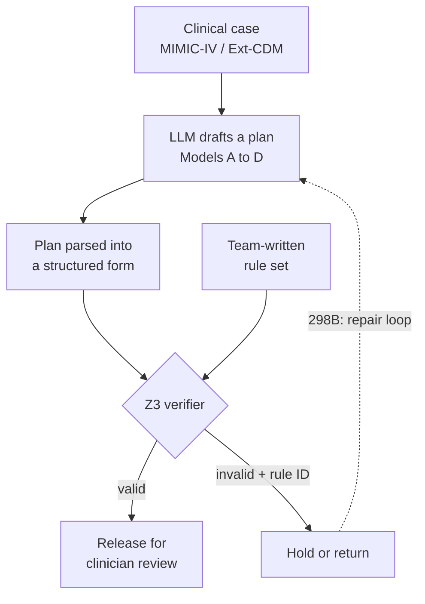
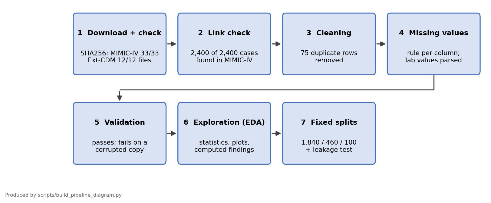
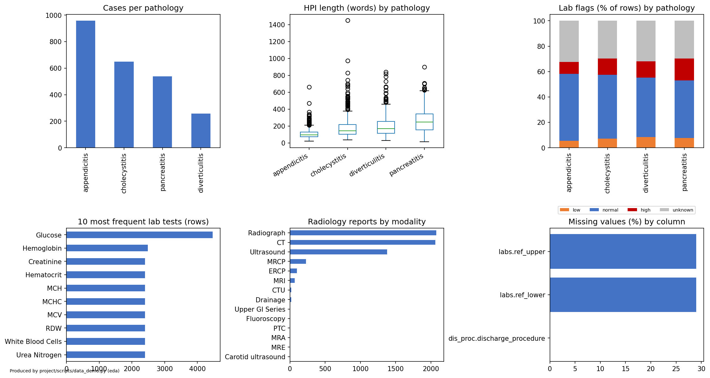
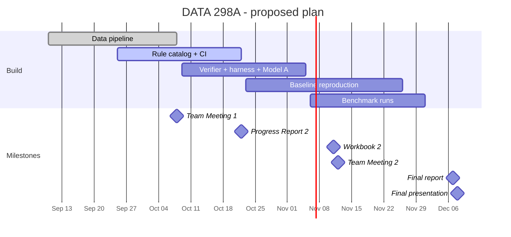

# Neurosymbolic Verification of LLM-Generated Clinical Discharge and Treatment Plans

DATA 298A (MSDA Project I) · Team 6 · Section 22 · Topic 12

Language models now draft discharge and treatment plans, and the plans read well even when they are unsafe: a plan can discharge a patient before required labs return, or order a contraindicated medication, and still look reasonable. This project builds a **checker that verifies an LLM-generated care plan against rules written by the team (not by the model) before anyone acts on it.** The checker turns each plan into logic, tests it with an SMT solver (Z3), and, when a plan fails, names the broken rule.

> **Scope:** a single hospital-encounter setting. This is an experimental verification framework, not a clinical decision support product. "Valid" means a plan complies with our formal rules; it does not prove the plan is clinically correct.

## Quickstart (no PhysioNet access needed)

The real data is credentialed and cannot be shared, so everything below runs on a **synthetic stand-in** with the same tables and columns (random values, nothing derived from real patients).

```bash
git clone https://github.com/Akashkumarsenthil/Clinical-Discharge-Treatment-Plan-Verification.git
cd Clinical-Discharge-Treatment-Plan-Verification
python -m venv .venv && source .venv/bin/activate
pip install -r requirements.txt

python -m pytest tests                                    # unit tests: synthetic data and toy rules only
python scripts/make_synthetic_data.py --out ~/synthetic_mimic
MIMIC_DIR=~/synthetic_mimic python scripts/data_demo.py all
python scripts/run_eval.py --plans tests/data/toy_labeled_plans.json --rules tests.toy_rules
python scripts/run_eval.py --plans tests/data/catalog_labeled_plans.json --rules clinverify.rules.catalog   # the draft rule catalog
```

| Command | What it shows |
|---|---|
| `data_demo.py all` | the data pipeline in order: integrity check, samples, cleaning (duplicates), missing-value rules, transformations, validation checks that pass and fail on corrupted data, EDA, and patient-grouped splits with leakage tests |
| `run_eval.py` | the Z3 verifier and evaluation harness: validity, escape rate, false rejects, solver time, and a logged run, first on toy rules and then on the draft rule catalog |

Runs on synthetic data write to `results/synthetic/` and never touch the real split file or EDA summary. With real PhysioNet access, point `MIMIC_DIR` at your own download instead (see Data and access).

## Approach



Four models are built and compared on the same benchmark and splits:

| Model | Idea | Phase |
|---|---|---|
| **A** | LLM generates discharge/treatment plans directly | 298A |
| **B** | LLM translates goals and clinical notes into formal specifications | 298B |
| **C** | LLM generation with a solver in the loop: the solver names the broken rule and returns it for repair | 298B |
| **D** | LLM paired with a classical PDDL planner | 298B |

**Baseline (separate from the four models):** we reproduce Hager et al. (2024), Fig. 3, where the best open LLM (OASST 70B) reaches 54.9% mean diagnostic accuracy on the autonomous MIMIC-CDM task (2,400 cases). That number measures *diagnosis*, so it is **not directly comparable** with our plan-validity metric.

## Evaluation

| Metric | Role |
|---|---|
| Plan validity rate | Primary: share of plans that satisfy the rule set |
| Constraint-violation escape rate | Secondary: invalid plans that the verifier lets through |
| Repair success rate, translation fidelity, solver cost | Secondary (targets set before the metrics are frozen) |

**Details and freeze status:** [docs/metrics.md](docs/metrics.md) (draft until the team freezes it).

**Target:** validity ≥ 0.85 and escape rate ≤ 0.05 on a fixed 100-case held-out split.

## Data and access

| Dataset | Version | Role |
|---|---|---|
| [MIMIC-IV](https://physionet.org/content/mimiciv/3.1/) | v3.1 | admissions, diagnoses, labs, medications, source records |
| [MIMIC-IV-Ext-CDM](https://physionet.org/content/mimic-iv-ext-cdm/) | v1.1 | 2,400 curated cases across four abdominal pathologies (Hager et al.) |

Both are **credentialed PhysioNet data** (PhysioNet Credentialed Health Data License 1.5.0). **No patient data is stored in this repository.**

- Each person needs their own PhysioNet credentialing and signed data use agreement; data is never shared between people.
- Data lives outside the repo (default `~/data/mimic`, override with the `MIMIC_DIR` environment variable). `.gitignore` blocks data files.
- MIMIC text must not be sent to hosted LLM APIs (see PhysioNet's [LLM guidance](https://physionet.org/news/post/llm-responsible-use/)); use local models or synthetic examples.
- The repo contains only code, configuration, dataset manifests, case-ID split lists, synthetic examples and aggregate results.

## Data pipeline (implemented)



Every step is a function in `scripts/data_demo.py` (`manifest`, `samples`, `clean`, `missing`, `transform`, `validate`, `eda`, `splits`) and in the notebook `notebooks/data_pipeline_demo.ipynb`. Aggregate output of the exploratory analysis (counts only, no patient text):



Main findings: classes are imbalanced (appendicitis 957 vs diverticulitis 257, 3.7x), about 29% of lab rows have no reference range (kept as `unknown`, never imputed), and 28.2% of flaggable lab results are abnormal.

## Project status

**DATA 298A (this semester):** verifier, team-written rule set, evaluation harness, benchmark, Model A, and the reproduced Hager et al. baseline.
**DATA 298B (next semester):** Models B, C and D, the full four-model comparison, expanded ablation and failure study, and a secondary case study on software deployment pipelines (which rules transfer, which do not).

| Workstream | State |
|---|---|
| Data access, manifests, integrity checks (SHA256) | done |
| Data cleaning, validation checks, EDA, fixed stratified splits grouped by patient (1,840 / 460 / 100, seed 298; split v2) | done (`src/clinverify/data`, `scripts/data_demo.py`) |
| Patient-level split leakage check (`scripts/patient_overlap_check.py`) | done: v1 had 5 of 2,383 patients crossing splits; fixed in v2 (0), see `docs/split_leakage_check.md` |
| Rule catalog and synthetic valid/invalid cases | **v2.0 for team sign-off**: 12 rules from 2025-2026 guidelines (sources within the course's 3-4 year limit), each with source location, strength, violation message and examples; 29 labeled synthetic plans; see `docs/rule_catalog.md` |
| Verifier (Z3), rule interface, evaluation harness | scaffold done and tested on toy rules (`scripts/run_eval.py`); waiting for the team's rules |
| Model A, baseline reproduction | planned (needs GPU access) |

### Schedule



## Repository layout

```
README.md
abstract/           the submitted project abstract (PDF), with a note on two out-of-date statements
papers/             31 PDFs: the 13 Workbook 1 papers, 10 later additions, and a medical LLM literature review set, with an index (papers/README.md)
report/             written report: Workbook 2 and final report (see report/README.md)
workbook/           Workbook 1 (report sections 1 and 2), submitted
presentation/       slides and demo material for the checkpoints
notebooks/          data pipeline demo (extraction, cleaning, EDA, splits)
scripts/            data_demo.py (data pipeline, one step at a time), make_synthetic_data.py, run_eval.py, patient_overlap_check.py
src/clinverify/
    data/           loading, cleaning, validation, splits and leakage checks; synthetic data generator
    plan.py         starter schema for a structured plan
    rules/          rule interface (done) and the rule catalog (v2.0, 12 rules from 2025-2026 sources, pending team sign-off)
    verifier/       plan -> Z3 check, names every violated rule (done, toy-tested)
    models/         Model A (298A); Models B, C, D (298B) (planned)
    baseline/       Hager et al. 2024 reproduction (planned)
    eval/           evaluation harness: validity, escape rate, false rejects, solver time, bootstrap intervals
tests/              unit tests on synthetic data and toy rules
.github/workflows/  CI: runs the tests on every push
data/               data/README.md; data/splits holds case IDs only (all patient data is gitignored)
docs/               data collection, data dictionary, metrics (draft), baseline notes, split leakage check, figures
results/            aggregate EDA summary (no patient data)
requirements.txt    pinned Python packages for the data pipeline
```

## Reproducibility

- Python 3.10+; install the pinned packages with `pip install -r requirements.txt`.
- Fixed, versioned splits; every reported run records its configuration and random seed.
- The data pipeline runs end to end with `python scripts/data_demo.py all`, on synthetic data (see Quickstart) or on the real data once it is downloaded to `MIMIC_DIR` (steps: `manifest`, `samples`, `clean`, `missing`, `transform`, `validate`, `eda`, `splits`). Tests: `python -m pytest tests`.
- Goal: another person can clone the repo and reproduce each reported result without help.

## Team

| Member | Current focus |
|---|---|
| Akash Senthilkumar | data access, manifest, ingestion |
| Ritika Mukesh Neema | Model A specification |
| Rajesh Paruchuri | metrics, splits, baseline protocol |
| Sneha Singh | rule catalog and synthetic cases |
| Shruthi Thirukumaran | environment, CI, reproducibility |

Task tracking in Linear (cycles, one assignee per issue, linked artifacts on closed issues):

- [All issues](https://linear.app/298a-team-6-neurosymbolic/team/T6/all)
- [Current cycle by assignee](https://linear.app/298a-team-6-neurosymbolic/view/team-6-board-current-cycle-by-assignee-be2c75252684) (dashboard view)
- [Project page](https://linear.app/298a-team-6-neurosymbolic/project/sec22-team6-topic12-neurosymbolic-verification-of-llm-plans-9c8482aa0d9c/overview) (milestones, status updates)

## References

The 13 papers used in the project plan (numbering matches Workbook 1). The full reading list, including later additions and the medical LLM literature review, is in [papers/README.md](papers/README.md).

1. Guan, L., Valmeekam, K., Sreedharan, S., & Kambhampati, S. (2023). Leveraging pre-trained large language models to construct and utilize world models for model-based task planning. *NeurIPS 36*. https://arxiv.org/abs/2305.14909
2. Hager, P., Jungmann, F., Holland, R., Bhagat, K., Hubrecht, I., Knauer, M., Vielhauer, J., Makowski, M., Braren, R., Kaissis, G., & Rueckert, D. (2024). Evaluation and mitigation of the limitations of large language models in clinical decision-making. *Nature Medicine*, 30, 2613-2622. https://doi.org/10.1038/s41591-024-03097-1 (**baseline to reproduce**)
3. Hekmatnejad, M., Simms, A. M., & Fainekos, G. (2019). Model checking clinical decision support systems using SMT. *arXiv:1901.04545*. https://arxiv.org/abs/1901.04545
4. Huang, J., Chen, X., Mishra, S., Zheng, H. S., Yu, A. W., Song, X., & Zhou, D. (2024). Large language models cannot self-correct reasoning yet. *ICLR*. https://arxiv.org/abs/2310.01798
5. Kambhampati, S., Valmeekam, K., Guan, L., Verma, M., Stechly, K., Bhambri, S., Saldyt, L. P., & Murthy, A. B. (2024). Position: LLMs can't plan, but can help planning in LLM-Modulo frameworks. *ICML*, PMLR 235, 22895-22907. https://proceedings.mlr.press/v235/kambhampati24a.html
6. Liu, B., Jiang, Y., Zhang, X., Liu, Q., Zhang, S., Biswas, J., & Stone, P. (2023). LLM+P: Empowering large language models with optimal planning proficiency. *arXiv:2304.11477*. https://arxiv.org/abs/2304.11477
7. Olausson, T. X., Inala, J. P., Wang, C., Gao, J., & Solar-Lezama, A. (2024). Is self-repair a silver bullet for code generation? *ICLR*. https://arxiv.org/abs/2306.09896
8. Pan, L., Albalak, A., Wang, X., & Wang, W. Y. (2023). Logic-LM: Empowering large language models with symbolic solvers for faithful logical reasoning. *Findings of EMNLP 2023*, 3806-3824. https://doi.org/10.18653/v1/2023.findings-emnlp.248
9. Shinn, N., Cassano, F., Berman, E., Gopinath, A., Narasimhan, K., & Yao, S. (2023). Reflexion: Language agents with verbal reinforcement learning. *NeurIPS 36*. https://arxiv.org/abs/2303.11366
10. Singhal, K., Azizi, S., Tu, T., Mahdavi, S. S., et al. (2023). Large language models encode clinical knowledge. *Nature*, 620, 172-180. https://doi.org/10.1038/s41586-023-06291-2
11. Valmeekam, K., Marquez, M., & Kambhampati, S. (2023a). Can large language models really improve by self-critiquing their own plans? *arXiv:2310.08118*. https://arxiv.org/abs/2310.08118
12. Valmeekam, K., Marquez, M., Olmo, A., Sreedharan, S., & Kambhampati, S. (2023b). PlanBench: An extensible benchmark for evaluating large language models on planning and reasoning about change. *NeurIPS 36 (Datasets and Benchmarks)*. https://arxiv.org/abs/2206.10498
13. Ye, X., Chen, Q., Dillig, I., & Durrett, G. (2023). SatLM: Satisfiability-aided language models using declarative prompting. *NeurIPS 36*. https://arxiv.org/abs/2305.09656

Tools and data: de Moura, L., & Bjørner, N. (2008). [Z3: An efficient SMT solver](https://doi.org/10.1007/978-3-540-78800-3_24). Johnson, A. E. W., et al. (2023). [MIMIC-IV, a freely accessible electronic health record dataset](https://doi.org/10.1038/s41597-022-01899-x). *Scientific Data*, 10, 1.
