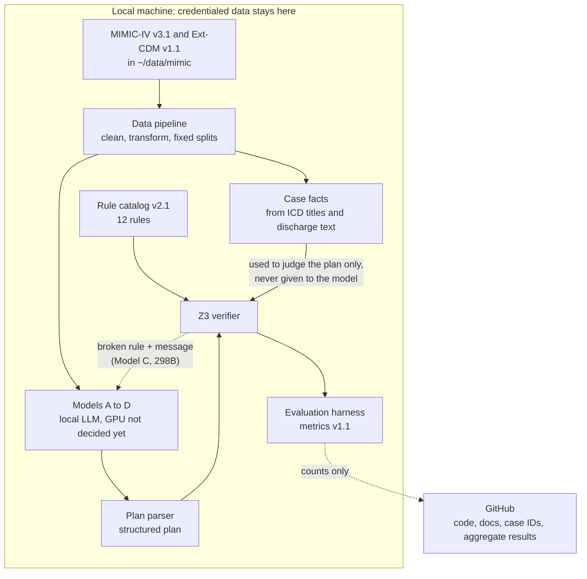

# Workbook 2 material: model development (sections 4.1 to 4.4)

Workbook 2 is report sections 3 and 4. Section 3 (data engineering) is in the notebook [`notebooks/data_pipeline_demo.ipynb`](../notebooks/data_pipeline_demo.ipynb), sections 5 to 8, where the code runs and shows its output. This page holds the model-development part, which is text and tables and describes models that do not exist yet.

This page is a draft built from what the repository already says (README, `docs/baseline_notes.md`, `docs/metrics.md`) and from the papers in `papers/`. Owners and dates are blank for the team to fill in. The strengths and limitations are our reading of the papers and the data so far. Nothing here is a result, because no model other than the verifier exists yet.

## 4.1 Model proposals

We build four models, one in 298A and three in 298B. The reproduced baseline is listed separately and is not one of the four.

| # | Model | Concept / architecture | Built in | Owner |
|---|---|---|---|---|
| 1 | A | An LLM generates the discharge and treatment plan directly. The plan is parsed into the structured form and checked by the Z3 verifier | 298A | |
| 2 | B | An LLM translates the clinical goals and notes into a formal specification; a solver does the reasoning | 298B | |
| 3 | C | LLM generation with the solver in the loop: the verifier names the broken rule and returns it to the LLM for repair | 298B | |
| 4 | D | An LLM paired with a classical PDDL planner | 298B | |
| — | Reproduced baseline | Hager et al. (2024), autonomous task on 2,400 cases; best open model OASST 70B, 54.9% mean diagnostic accuracy (Fig. 3). It measures diagnosis, not plan validity | 298A | |

## 4.2 Model supports: platform and architecture

The patient data, the models and the verifier all run on a local machine. Only code, documents, case IDs and aggregate counts go to GitHub. MIMIC text is never sent to a hosted LLM, which PhysioNet's data-use rules require.

| Part | What it is |
|---|---|
| Language and libraries | Python (runs verified on 3.13.5, GitHub Actions uses 3.12), pandas, numpy, matplotlib, z3-solver 5.3.1, pytest (`requirements.txt`) |
| Where code is checked | unit tests with `pytest`, run in GitHub Actions on every push |
| Where data lives | outside the repo, in `~/data/mimic`, and `.gitignore` blocks data files |
| Where the models run | local only. The GPU or the smaller fallback model is not decided yet, so this part of the diagram is open |

To use the diagram in the Word report, export it as an image. Mermaid only renders on GitHub and in some notebook viewers.

## 4.3 Comparison and justification

| | Model A | Model B | Model C | Model D |
|---|---|---|---|---|
| Targeted problem | plain plan generation, the reference for the rest | plans that are faithful to a formal reading of the case | plans that are corrected until they pass the rules | plans that are valid by construction for a planning domain |
| Input | case history, with exam, labs and imaging requested step by step (Hager et al.) | case text | case text plus verifier feedback | case text plus a domain model |
| Approach | LLM prompting (deep learning) | LLM translation plus a deterministic solver (Logic-LM, SatLM, Faithful-CoT) | LLM plus an external critic in a loop (LLM-Modulo, Logic-LM self-refine) | LLM translation plus a classical planner (LLM+P) |
| Strength | simplest; closest to the baseline paper; no translation step | the solver does the reasoning, so the explanation matches the answer | uses the rule catalog directly and names the broken rule | the planner's output follows the domain model |
| Limitation | no correction step; Hager et al. report that LLMs often skip guideline-recommended treatment | translation errors (counted as translation fidelity); the formal language has to cover each diagnosis | can only repair what the rules cover; an unknown fact gives no feedback; costs extra solver calls and generations | needs a clinical planning domain written in PDDL, which does not exist yet and is hard to write |
| Phase | 298A | 298B | 298B | 298B |

**Justification.** All four models are scored on the same 100 test cases with the same verifier, so the only thing that changes is the method. The baseline sits outside the four as the published reference point.

**Where a model would lose.** We haven't chosen a preferred model yet. These are draft conditions for the team to confirm:

- Model A loses to B, C and D whenever correction matters, because it never sees why a plan failed.
- Model B loses when the notes are too long or messy to translate correctly. Pancreatitis notes have a median of 248 words against 95 for appendicitis (notebook section 3).
- Model C loses when most facts are unknown. Six of 12 rules can be checked on at most one case from the facts alone (notebook section 6.3), so there is little to feed back.
- Model D loses when the care step cannot be written as an action with a precondition, as with the lab-dependent and conditional guideline rules.

## 4.4 Evaluation methods

The definitions are in [`metrics.md`](metrics.md) (protocol v1.1, frozen locally on October 23, 2026) and [`evaluation_protocol.json`](evaluation_protocol.json). If this page and `metrics.md` ever differ, `metrics.md` is right. No Model A output exists yet. The table below is the same content in the shape the template asks for.

| Metric | Why this metric | Measured on | Committed on |
|---|---|---|---|
| `diagnosis_accuracy` | the baseline paper's headline number; reproduces a published reference | all 100 test cases | Oct 23, 2026 |
| `supported_checked_acceptance_rate` (primary, descriptive, no numeric target) | share of covered cases with a correct diagnosis and a plan accepted after at least one decided blocking clinical rule; scope-only or advisory-only acceptance earns no credit | the 73 covered test cases | Oct 23, 2026 |
| `joint_success_rate` | correct diagnosis and an accepted plan together | all 100 test cases | Oct 23, 2026 |
| Escape rate, target <= 0.05 | bad plans that the verifier lets through, measured on independently labelled plans | independently labelled plans (labelling not yet done) | Oct 23, 2026 |
| `adjudicated_treatment_validity_rate`, research goal 0.85 | independent human judgement of treatment validity | record-evaluable covered cases (human review not yet done) | Oct 23, 2026 |

Runs use seeds 298, 299 and 300. Missing or unparseable plans count as failures. Results are reported per pathology next to the overall number.

Runs use seeds 298, 299 and 300. Missing or unparseable plans count as failures. Results are reported per pathology next to the overall number.

## Carry-forward from Workbook 1 and the abstract

| Item | Why it did not land, or what changed | New target |
|---|---|---|
| Plan validity >= 0.85 (abstract) | With the facts the record supports, no model can reach 0.85 automatically. The ceiling on the 73 covered test cases is 47 (64.4%) for the legacy acceptance diagnostic and 18 (24.7%) for checked acceptance, even with a perfect diagnosis (`docs/evaluation_feasibility.md`). Protocol v1.1 removes 0.85 as an automatic target | 0.85 kept only as a research goal on independently human-adjudicated plans. No numeric target on the automatic rates |
| Escape rate <= 0.05 (abstract) | unchanged | unchanged, measured on independently labelled plans |
| Human check of the derived case facts (116 cases) | done on 2026-10-27 by one team member: 116 of 116 reviewed, 100% agreement with the extraction. It is a consistency check against the mapping, not an independent clinician review | an independent reviewer, if the team wants a stronger validation |
| Second review of the rule catalog | pending | second reviewer signs `docs/rule_signoff.md` |
| Baseline reproduction (Hager et al., 54.9%) | not run: needs a GPU or an agreed smaller model | Workbook 2 keeps 4.5 and 4.6 as headings, per the template |

## Self-assessment and gap register

Ratings are our first guess from the evidence in the notebook and on this page. The team should confirm or change them.

| Report section | Our rating | If below good: what is missing | Owner | Lands by |
|---|---|---|---|---|
| 3.1–3.6 Data engineering | good | none known. Notes and labs are not shown, only case IDs and counts, because the data is credentialed | | |
| 4.1 Model proposals | poor | the owner of each model (table 10.1) | | Nov 11, 2026 |
| 4.2 Model supports | good | the diagram is a draft; the GPU or fallback model is still open, and it needs exporting as an image for the report | | |
| 4.3 Comparison | good | the team has not yet reviewed the strengths and limitations in 10.2 | | |
| 4.4 Evaluation methods | good | independently labelled plans and the label scorer are not built, so the escape rate and the 0.85 research goal can't be measured yet | | |
| References | good | the list is in section 12; add any source the team introduces later | | |

## References

- Hager, P., et al. (2024). Evaluation and mitigation of the limitations of large language models in clinical decision-making. *Nature Medicine*, 30, 2613–2622. https://doi.org/10.1038/s41591-024-03097-1
- Johnson, A., et al. (2023). MIMIC-IV, a freely accessible electronic health record dataset. *Scientific Data*. PhysioNet, v3.1.
- Kambhampati, S., et al. (2024). Position: LLMs can't plan, but can help planning in LLM-Modulo frameworks. *Proceedings of ICML*, PMLR 235.
- Pan, L., Albalak, A., Wang, X., & Wang, W. Y. (2023). Logic-LM: Empowering large language models with symbolic solvers for faithful logical reasoning.
- Ye, X., Chen, Q., Dillig, I., & Durrett, G. (2023). SatLM: Satisfiability-aided language models using declarative prompting.
- Lyu, Q., et al. (2023). Faithful chain-of-thought reasoning.
- Liu, B., et al. (2023). LLM+P: Empowering large language models with optimal planning proficiency.
- Hekmatnejad, M., Simms, A. M., & Fainekos, G. (2019). Model checking clinical decision support systems using SMT. arXiv:1901.04545.
- Oniani, D., et al. (2024). Enhancing large language models for clinical decision support by incorporating clinical practice guidelines.
- de Moura, L., & Bjørner, N. (2008). Z3: An efficient SMT solver. *TACAS*.
- Rule sources (catalog v2.1): the 2025 WSES Jerusalem guidelines for acute appendicitis (Podda et al., JAMA Surg 2026;161:283-295, abstract only); the Ibero-Latin American guidelines on acute pancreatitis (Cardenas-Jaen et al., UEG J 2026;14:e70190); the ACG clinical guideline on colonic diverticulitis (Peery et al., Am J Gastroenterol 2026;121:1549-1561, abstract only); the Korean guidelines for acute colonic diverticulitis (Lee et al., Intest Res 2026;24:428-463).

## Still open

- The owner of each model in the table in 4.1.
- 4.5 and 4.6, which stay as headings, as the template says.
